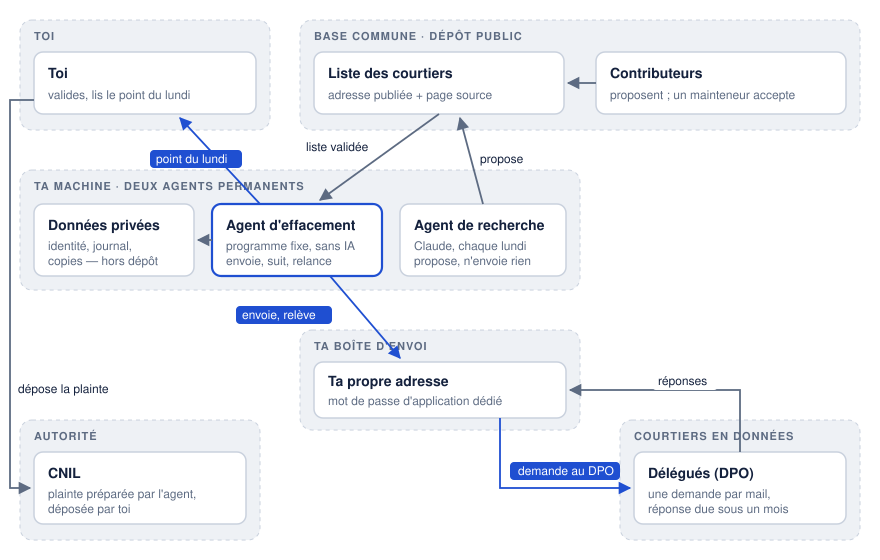
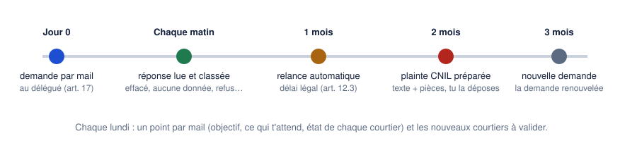

# Effacement de données

Un agent qui tourne sur ta machine et demande, à ta place et en ton nom, aux courtiers en données d'effacer tes données personnelles (droit à l'effacement, article 17 du RGPD). Il fait le travail d'un service comme Incogni, en clair : chaque demande, chaque réponse et chaque relance restent chez toi.



## Ce qu'il fait
- **Il écrit au délégué à la protection des données de chaque courtier**, depuis ta propre boîte mail, avec un modèle repris de la CNIL : effacement (article 17), opposition à la prospection (article 21), notification aux destinataires (article 19). Deux demandes le mardi, deux le jeudi.
- **Il lit les réponses chaque matin** et les classe : effacé, aucune donnée, refus, accusé de réception, pièce demandée. Il suit seul un lien de confirmation authentique, et répond une fois à un courtier qui renvoie vers son formulaire : le mail suffit (voir plus bas).
- **Il relance après un mois** (délai légal, article 12.3), puis **prépare la plainte à la CNIL** : le texte et les pièces numérotées, que tu déposes.
- **Il t'envoie un point chaque lundi** : où en est l'objectif, ce qui t'attend, l'état de chaque courtier, et les nouveaux courtiers à valider.
- **Un agent de recherche** (Claude Code) cherche chaque lundi de nouveaux courtiers et l'adresse que chacun publie. Il ne fait que proposer : une réponse « OUI » au point les ajoute à ta liste.



## Ce qui reste à toi
Installer une fois, valider le modèle et la liste, dire « OUI » aux nouvelles adresses, déposer une plainte quand l'agent l'a préparée. Aucun mandat à signer : les demandes partent de ta boîte, tu exerces toi-même ton droit. La machine doit rester allumée.

## Le mail suffit
Le RGPD n'impose aucune forme à une demande. Un courtier peut proposer un formulaire, mais une demande envoyée à l'adresse qu'il publie pour les droits est en général effective et doit être traitée (Comité européen de la protection des données, [lignes directrices 01/2022](https://www.edpb.europa.eu/system/files/2023-04/edpb_guidelines_202201_data_subject_rights_access_v2_en.pdf), points 52-53). Le projet n'écrit donc que par mail et ne passe jamais par un formulaire ni un captcha.

## Installation
Le plus simple : copier `skill/effacement-donnees/` dans `~/.claude/skills/`, puis dire à Claude Code « installe l'agent d'effacement ». Il conduit l'installation une question à la fois. À la main :

```sh
git clone <ce dépôt> ~/effacement-donnees && cd ~/effacement-donnees
python3 -m venv .venv && .venv/bin/pip install pillow        # filigrane de la pièce d'identité (facultatif)
echo '{"nom": "…", "mails": ["…"], "telephones": ["…"], "adresses": ["…"], "expediteur": "…", "destinataire_point": "…"}' | python3 installer.py identite
echo '<mot de passe d application>' | python3 installer.py boite yahoo <adresse>   # ou gmail, ou "imap.x:smtp.x"
python3 installer.py piece recto.jpg     # facultatif
python3 installer.py calendrier          # pose les tâches planifiées (cron)
python3 installer.py essai               # un tour à blanc : rien n'est envoyé
python3 installer.py etat
```

Prérequis : Python 3.9 ou plus, une machine allumée en permanence, Claude Code pour l'agent de recherche.

## Données et sécurité
Tout ce qui est personnel reste dans `donnees/`, sur ta machine, hors du dépôt. Les risques pris en compte (faux courtier, faux mail qui réclame la pièce d'identité, lien piégé) et leurs parades sont dans [`SECURITY.md`](SECURITY.md).

## La liste des courtiers
[`docs/courtiers.md`](docs/courtiers.md) : chaque courtier, l'adresse qu'il publie et la page source. Elle est ouverte aux contributions, acceptées par un mainteneur humain : voir [`CONTRIBUTING.md`](CONTRIBUTING.md).

## Pour aller plus loin
- [`docs/recherche.md`](docs/recherche.md) : le cadre légal et les sources.
- [`docs/modele-demande.md`](docs/modele-demande.md) : tous les mails que l'agent peut envoyer.
- `effacement/agent.py` : le programme (`python3 agent.py --help`).

## Licence
MIT, voir [`LICENSE`](LICENSE).
