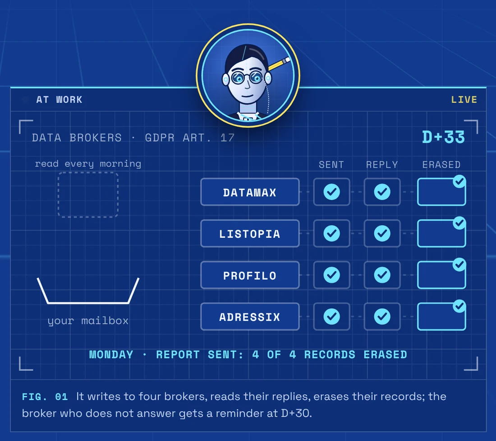
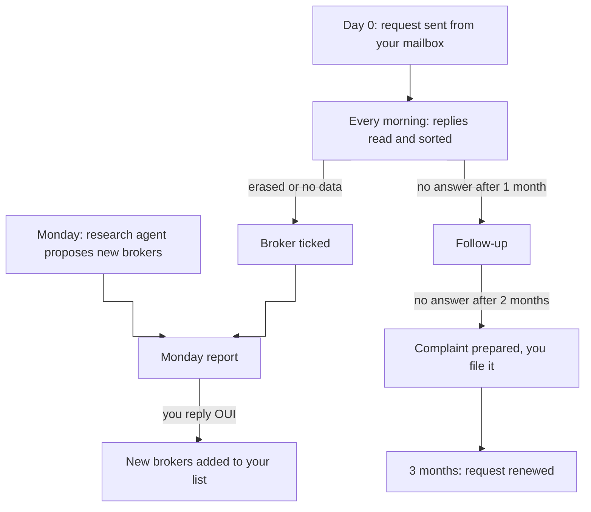
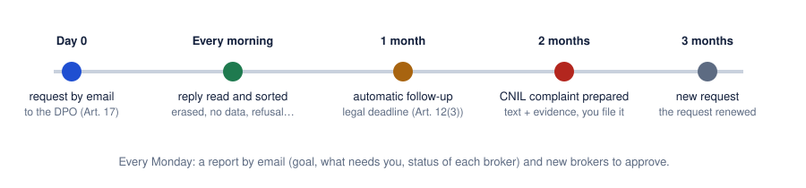
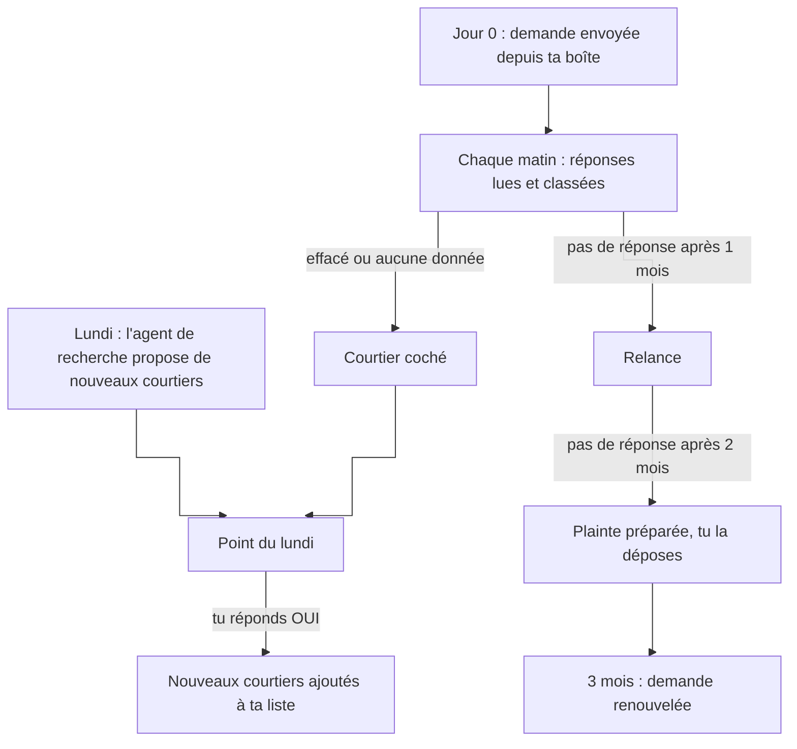

# Agent - Data Eraser

For people in the European Union: it asks data brokers, on your behalf, to erase your personal data (GDPR right to erasure), from your own mailbox and your own machine.

[](https://ingevision.cloud/en/ai-agents/?p=agent-effaceur-de-donnees)

**English** · [Français](#version-française)

*One letter, one reminder, one tick.*

A permanent agent, France first for now. It runs on your own machine and asks data brokers, in your name, to erase your personal data (Article 17 GDPR). It does the job of a paid service like Incogni, in the open: every request, reply and follow-up stays with you.

## What it does

- **Writes to data brokers, from your mailbox.** It emails each broker's data protection officer using a template based on the French regulator's (CNIL) model: erasure (Art. 17), objection to direct marketing (Art. 21), notification of recipients (Art. 19). Two requests on Tuesdays, two on Thursdays.
- **Reads and sorts their replies every morning**: erased, no data held, refusal, acknowledgement, ID requested. It follows a genuine confirmation link on its own, and answers once to a broker that points to its web form: email is enough.
- **Follows up at 1 month, drafts the regulator complaint at 2.** The follow-up comes one month after the request (legal deadline, Art. 12(3)); one month later it prepares the complaint to the CNIL, the text and the numbered evidence, which you file. Three months after the request, it renews it.
- **Reports every Monday**: progress towards the goal, what needs you, the status of each broker, and new brokers to approve.

A **research agent** (Claude Code) looks for new brokers every Monday, with the address each one publishes. It only proposes: replying "OUI" (yes) to the Monday report adds them to your list.

Two options:

- **A Chrome extension deletes tracking cookies** every week ([`navigateur/`](navigateur)): those of ad networks, analytics tools and social networks (public list by [Disconnect](https://github.com/disconnectme/disconnect-tracking-protection), downloaded at each pass), except for sites you visited yourself in the last 90 days, which keeps your logins.
- **It sorts the spam that gets past your provider's filter**: every morning a small AI model (Claude Haiku) reads new mail and moves spam to a separate folder, listed in the Monday report and deleted 30 days later. It never touches brokers' mail, your own, or mail from anyone you have written to. `installer.py spams oui` turns it on, `./lancer.sh tri trier --essai` shows its verdicts without moving anything.

It is meant for anyone who wants their data removed from brokers' files, as with a paid service, while keeping everything at home.

## How it works





| Does on its own | Leaves to you |
|---|---|
| Send the requests and follow-ups, read and sort the replies, follow a genuine confirmation link, answer once a broker that points to its form, prepare the complaint text and documents. | Approve the letter template and the broker list, say "OUI" to newly suggested brokers, file the complaint the agent has prepared. |

No power of attorney to sign: requests leave from your own mailbox, so you exercise your right yourself.

### Email is enough

The GDPR imposes no form for a request. A broker may offer a web form, but a request sent to the address it publishes for privacy rights is in general effective and must be handled (European Data Protection Board, [Guidelines 01/2022](https://www.edpb.europa.eu/system/files/2023-04/edpb_guidelines_202201_data_subject_rights_access_v2_en.pdf), points 52-53: written for the right of access, they apply GDPR Article 12, common to all rights). So the project only ever writes by email, never through a form or a captcha.

### Scope

For people in the EU, the EEA and the UK. Requests are written in French or English (`langue`), and the agent names your own country's authority and prepares the complaint for it: [`docs/autorites.md`](docs/autorites.md) lists the 31 authorities and their complaint pages. It has been used for real in France first; the broker list ([`docs/courtiers.md`](docs/courtiers.md)) is mostly French and international for now.

## Requirements

- Linux or macOS (the schedule uses cron), Python 3.9+, a machine that stays on.
- An IMAP mailbox with an app-specific login for the agent; `installer.py` knows two common webmail providers and accepts any other as `imap-server:smtp-server`. Outlook.com is not supported yet (it requires OAuth).
- Optional: Pillow (watermark on the ID copy) and Playwright (to follow confirmation links). Without them, those two cases come back to you instead of being handled.
- Claude Code, for the research agent and the spam sorting. The core is plain Python and needs no AI; `RECHERCHE_CMD` and `TRI_CMD` plug in another tool (only the Claude Code setup has been tested, see [`AGENTS.md`](AGENTS.md)).

## Install

Easiest: clone the repository, copy `skill/effacement-donnees/` into `~/.claude/skills/`, then tell Claude Code "installe l'agent d'effacement". It walks you through the setup one question at a time. By hand:

```sh
git clone https://github.com/anthohunt/agent-eu-data-eraser ~/agent-eu-data-eraser && cd ~/agent-eu-data-eraser
python3 -m venv .venv && .venv/bin/pip install pillow playwright && .venv/bin/playwright install chromium
echo '{"nom": "…", "mails": ["…"], "telephones": ["…"], "adresses": ["…"], "pays": "DE", "langue": "en", "expediteur": "…", "destinataire_point": "…"}' | python3 installer.py identite
echo '<app-specific login>' | python3 installer.py boite <provider> <address>   # provider known to installer.py, or "imap.x:smtp.x"
python3 installer.py piece front.jpg     # optional: ID card, for authenticated requests only
python3 installer.py calendrier          # installs the schedule (cron)
python3 installer.py essai               # a dry run: nothing is sent
python3 installer.py etat
```

Chrome extension, once: `chrome://extensions`, developer mode, "Load unpacked", folder `navigateur/`.

Everything personal stays in `donnees/`, on your machine, outside the repository. The risks considered (fake broker, fake email asking for your ID, booby-trapped link, prompt injection) and how they are handled are in [`SECURITY.md`](SECURITY.md). Broker contributions are welcome and accepted by a human maintainer: see [`CONTRIBUTING.md`](CONTRIBUTING.md).

Further reading (in French): [`docs/recherche.md`](docs/recherche.md) (legal framework and sources), [`docs/modele-demande.md`](docs/modele-demande.md) (every email the agent can send), `effacement/agent.py` (`python3 agent.py --help`).

License: MIT, see [`LICENSE`](LICENSE).

## Its page

- English: <https://ingevision.cloud/en/ai-agents/?p=agent-effaceur-de-donnees>
- Français : <https://ingevision.cloud/agents-ia/?p=agent-effaceur-de-donnees>

---

## Version française

# Agent - Effaceur de données

Pour les personnes qui vivent dans l'Union européenne : il demande à ta place aux courtiers en données d'effacer tes données personnelles (droit à l'effacement, RGPD), depuis ta propre boîte mail et ta propre machine.

[](https://ingevision.cloud/agents-ia/?p=agent-effaceur-de-donnees)

*Une lettre, une relance, une coche.*

Un agent permanent, la France d'abord pour l'instant. Il tourne sur ta machine et demande, en ton nom, aux courtiers en données d'effacer tes données personnelles (article 17 du RGPD). Il fait le travail d'un service payant comme Incogni, en clair : chaque demande, chaque réponse et chaque relance restent chez toi.

### Ce qu'il fait

- **Écrit aux courtiers en données, depuis ta boîte.** Il écrit au délégué à la protection des données de chaque courtier, avec un modèle repris de la CNIL : effacement (article 17), opposition à la prospection (article 21), notification aux destinataires (article 19). Deux demandes le mardi, deux le jeudi.
- **Lit et classe leurs réponses chaque matin** : effacé, aucune donnée, refus, accusé de réception, pièce demandée. Il suit seul un lien de confirmation authentique, et répond une fois à un courtier qui renvoie vers son formulaire : le mail suffit.
- **Relance à 1 mois, prépare la plainte CNIL à 2.** La relance part un mois après la demande (délai légal, article 12.3) ; un mois plus tard, il prépare la plainte à la CNIL, le texte et les pièces numérotées, que tu déposes. Trois mois après la demande, il la renouvelle.
- **Fait le point chaque lundi** : où en est l'objectif, ce qui t'attend, l'état de chaque courtier, et les nouveaux courtiers à valider.

Un **agent de recherche** (Claude Code) cherche chaque lundi de nouveaux courtiers et l'adresse que chacun publie. Il ne fait que proposer : une réponse « OUI » au point les ajoute à ta liste.

Deux options :

- **Une extension Chrome efface les cookies de pistage** chaque semaine ([`navigateur/`](navigateur)) : ceux des régies publicitaires, des outils de mesure d'audience et des réseaux sociaux (liste publique de [Disconnect](https://github.com/disconnectme/disconnect-tracking-protection), téléchargée à chaque passe), sauf pour les sites que tu as visités toi-même ces 90 derniers jours, ce qui garde tes connexions.
- **Il trie les spams qui passent le filtre** de ta messagerie : chaque matin, un petit modèle d'IA (Claude Haiku) lit les mails arrivés et range les spams dans un dossier à part, listés dans le point du lundi et effacés 30 jours plus tard. Il ne touche jamais aux courriers des courtiers, aux tiens, ni à ceux de quelqu'un à qui tu as écrit. `installer.py spams oui` l'active, `./lancer.sh tri trier --essai` montre ses verdicts sans rien déplacer.

Il sert à toute personne qui veut faire disparaître ses données des fichiers des courtiers, comme avec un service payant, mais en gardant tout chez soi.

### Comment il marche




| Fait seul | Te laisse |
|---|---|
| Envoyer les demandes et les relances, lire et classer les réponses, suivre un lien de confirmation authentique, répondre une fois à un courtier qui renvoie vers son formulaire, préparer le texte et les pièces de la plainte. | Valider le modèle de lettre et la liste des courtiers, dire « OUI » aux nouveaux courtiers proposés, déposer la plainte que l'agent a préparée. |

Aucun mandat à signer : les demandes partent de ta boîte, tu exerces toi-même ton droit.

#### Le mail suffit

Le RGPD n'impose aucune forme à une demande. Un courtier peut proposer un formulaire, mais une demande envoyée à l'adresse qu'il publie pour les droits est en général effective et doit être traitée (Comité européen de la protection des données, [lignes directrices 01/2022](https://www.edpb.europa.eu/system/files/2023-04/edpb_guidelines_202201_data_subject_rights_access_v2_en.pdf), points 52-53 : écrites pour le droit d'accès, elles appliquent l'article 12 du RGPD, commun à tous les droits). Le projet n'écrit donc que par mail et ne passe jamais par un formulaire ni un captcha.

#### Portée

Pour les personnes qui vivent dans l'UE, l'EEE ou au Royaume-Uni. Les demandes partent en français ou en anglais (`langue`), et l'agent cite l'autorité de ton pays et prépare la plainte pour elle : [`docs/autorites.md`](docs/autorites.md) liste les 31 autorités et leur page de plainte. Il a d'abord servi pour de vrai en France ; la liste des courtiers ([`docs/courtiers.md`](docs/courtiers.md)) est surtout française et internationale pour l'instant.

### Ce qu'il faut

- Linux ou macOS (le calendrier utilise cron), Python 3.9 ou plus, une machine allumée en permanence.
- Une boîte IMAP avec un code d'accès propre à l'application ; `installer.py` connaît deux messageries courantes et accepte toute autre sous la forme `serveur-imap:serveur-smtp`. Pas encore Outlook.com, qui exige une connexion OAuth.
- Facultatif : Pillow (filigrane de la pièce d'identité) et Playwright (suivre les liens de confirmation). Sans eux, ces deux cas te remontent au lieu d'être traités seuls.
- Claude Code, pour l'agent de recherche et le tri des spams. Le cœur est un programme Python ordinaire, sans IA ; `RECHERCHE_CMD` et `TRI_CMD` permettent de brancher un autre outil (seul Claude Code a été testé, voir [`AGENTS.md`](AGENTS.md)).

### Installation

Le plus simple : cloner le dépôt, copier `skill/effacement-donnees/` dans `~/.claude/skills/`, puis dire à Claude Code « installe l'agent d'effacement ». Il conduit l'installation une question à la fois. À la main :

```sh
git clone https://github.com/anthohunt/agent-eu-data-eraser ~/agent-eu-data-eraser && cd ~/agent-eu-data-eraser
python3 -m venv .venv && .venv/bin/pip install pillow playwright && .venv/bin/playwright install chromium
echo '{"nom": "…", "mails": ["…"], "telephones": ["…"], "adresses": ["…"], "pays": "FR", "langue": "fr", "expediteur": "…", "destinataire_point": "…"}' | python3 installer.py identite
echo '<code d application>' | python3 installer.py boite <fournisseur> <adresse>   # fournisseur connu d'installer.py, ou "imap.x:smtp.x"
python3 installer.py piece recto.jpg     # facultatif
python3 installer.py calendrier          # pose les tâches planifiées (cron)
python3 installer.py essai               # un tour à blanc : rien n'est envoyé
python3 installer.py etat
```

Extension Chrome, une fois : `chrome://extensions`, mode développeur, « Charger l'extension non empaquetée », dossier `navigateur/`.

Tout ce qui est personnel reste dans `donnees/`, sur ta machine, hors du dépôt. Les risques pris en compte (faux courtier, faux mail qui réclame la pièce d'identité, lien piégé, page web qui donne des ordres à l'agent) et leurs parades sont dans [`SECURITY.fr.md`](SECURITY.fr.md). La liste des courtiers est ouverte aux contributions, acceptées par un mainteneur humain : voir [`CONTRIBUTING.fr.md`](CONTRIBUTING.fr.md).

Pour aller plus loin : [`docs/recherche.md`](docs/recherche.md) (cadre légal et sources), [`docs/modele-demande.md`](docs/modele-demande.md) (tous les mails que l'agent peut envoyer), `effacement/agent.py` (`python3 agent.py --help`).

Licence : MIT, voir [`LICENSE`](LICENSE).

### Sa fiche

- Français : <https://ingevision.cloud/agents-ia/?p=agent-effaceur-de-donnees>
- English: <https://ingevision.cloud/en/ai-agents/?p=agent-effaceur-de-donnees>

---

**Anthony Hunt** · [Agent page on ingevision.cloud](https://ingevision.cloud/en/ai-agents/?p=agent-effaceur-de-donnees) · [LinkedIn](https://www.linkedin.com/in/anthony-hunt-3948a9196) · [GitHub profile](https://github.com/anthohunt) · anthony@ingevision.cloud
