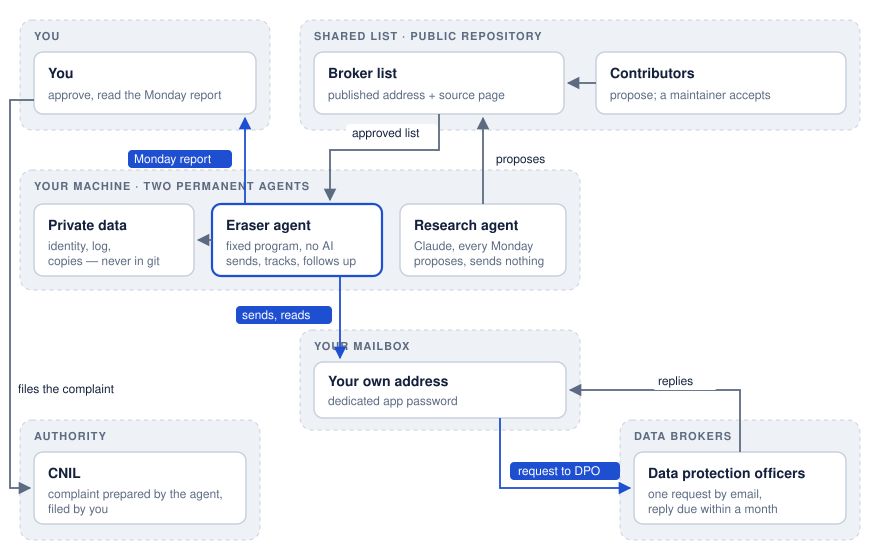

# Agent - EU Data Eraser

*English · [Français](README.fr.md)*

A permanent agent for people in the European Union, France first for now. It runs on your own machine and asks data brokers, on your behalf and in your name, to erase your personal data (right to erasure, Article 17 GDPR). It does the job of a service like Incogni, in the open: every request, reply and follow-up stays with you.



## What it does
- **It emails each broker's data protection officer** from your own mailbox, using a template based on the French regulator's (CNIL) model: erasure (Art. 17), objection to direct marketing (Art. 21), notification of recipients (Art. 19). Two requests on Tuesdays, two on Thursdays.
- **It reads the replies every morning** and sorts them: erased, no data held, refusal, acknowledgement, ID requested. It follows a genuine confirmation link on its own, and answers once to a broker that points to its web form: email is enough (see below).
- **It follows up one month after the request** (legal deadline, Art. 12(3)) and, one month after the follow-up, **prepares the complaint to the CNIL**: the text and the numbered evidence, which you file. Three months after the request, it renews it.
- **It sends you a report every Monday**: progress towards the goal, what needs you, the status of each broker, and new brokers to approve.
- **A research agent** (Claude Code) looks for new brokers every Monday, with the address each one publishes. It only proposes: replying "OUI" (yes) to the Monday report adds them to your list.


## What is left to you
Install once, approve the template and the list, say yes to new addresses, file a complaint when the agent has prepared it. No power of attorney to sign: requests leave from your own mailbox, so you exercise your right yourself. The machine must stay on.

## Email is enough
The GDPR imposes no form for a request. A broker may offer a web form, but a request sent to the address it publishes for privacy rights is in general effective and must be handled (European Data Protection Board, [Guidelines 01/2022](https://www.edpb.europa.eu/system/files/2023-04/edpb_guidelines_202201_data_subject_rights_access_v2_en.pdf), points 52-53: written for the right of access, they apply GDPR Article 12, common to all rights). So the project only ever writes by email, never through a form or a captcha.

## Scope
For people in the EU, the EEA and the UK. The requests are written in French or English (`langue`), and the agent names your own country's authority and prepares the complaint for it: [`docs/autorites.md`](docs/autorites.md) lists the 31 authorities and their complaint pages, read on their official sites (Lithuania's site could not be read). It has been used for real in France first; the broker list is mostly French and international for now.

## Installation
Easiest: clone the repository, copy `skill/effacement-donnees/` into `~/.claude/skills/`, then tell Claude Code "installe l'agent d'effacement". It walks you through the setup one question at a time. By hand:

```sh
git clone https://github.com/anthohunt/agent-eu-data-eraser ~/agent-eu-data-eraser && cd ~/agent-eu-data-eraser
python3 -m venv .venv && .venv/bin/pip install pillow playwright && .venv/bin/playwright install chromium
echo '{"nom": "…", "mails": ["…"], "telephones": ["…"], "adresses": ["…"], "pays": "DE", "langue": "en", "expediteur": "…", "destinataire_point": "…"}' | python3 installer.py identite
echo '<app password>' | python3 installer.py boite yahoo <address>   # or gmail, or "imap.x:smtp.x"
python3 installer.py piece front.jpg     # optional: ID card, for authenticated requests only
python3 installer.py calendrier          # installs the schedule (cron)
python3 installer.py essai               # a dry run: nothing is sent
python3 installer.py etat
```

Requirements: Linux or macOS (the schedule uses cron), Python 3.9+, a machine that stays on. Pillow watermarks the ID copy and Playwright follows confirmation links: without them, those two cases come back to you instead of being handled. Claude Code runs the research agent.

## Works with other AI tools
The core is plain Python and needs no AI. The setup skill is plain text that any coding agent can follow (see [`AGENTS.md`](AGENTS.md)). The research agent uses Claude Code by default; set `RECHERCHE_CMD` to any command that reads the instructions on stdin and edits `docs/courtiers-proposes.json` in its working folder (Codex, Gemini CLI…), with the same limits: web search, read access to that folder, no shell. Only the Claude Code setup has been tested.

## Data and security
Everything personal stays in `donnees/`, on your machine, outside the repository. The risks considered (fake broker, fake email asking for your ID, booby-trapped link, prompt injection) and how they are handled are in [`SECURITY.md`](SECURITY.md).

## The broker list
[`docs/courtiers.md`](docs/courtiers.md): each broker, the address it publishes and the source page. Contributions are welcome and accepted by a human maintainer: see [`CONTRIBUTING.md`](CONTRIBUTING.md).

## Further reading (in French)
- [`docs/recherche.md`](docs/recherche.md): legal framework and sources.
- [`docs/modele-demande.md`](docs/modele-demande.md): every email the agent can send.
- `effacement/agent.py`: the program (`python3 agent.py --help`).

## License
MIT, see [`LICENSE`](LICENSE).
